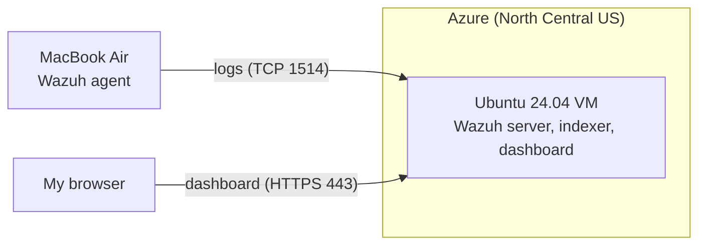
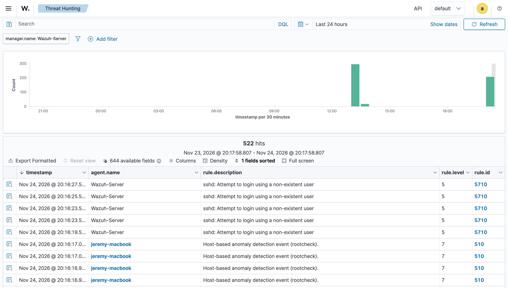

# SIEM Home Lab

A SIEM I set up in Azure to learn how security monitoring and detection actually work. It runs Wazuh on a cloud VM and monitors my MacBook through the Wazuh agent.

I'm using it to practice writing detection rules, triaging alerts, and eventually feeding its vulnerability findings into my [vulnerability prioritization tool](https://github.com/jeremywhitlockk/vulnerability-prioritization-tool).

## Setup

- **SIEM:** Wazuh 4.14, all-in-one install (server, indexer and dashboard on one VM)
- **Server:** Azure B2as v2 VM (2 vCPU, 8 GB RAM), Ubuntu 24.04, 64 GB disk
- **Monitored:** my MacBook Air (Apple Silicon) running the Wazuh agent
- **Cost:** free, running on Azure for Students credit

I ran it in the cloud because my laptop only has 8 GB of RAM, which isn't enough to run Wazuh and a machine for it to monitor at the same time.

## What it looks like

*My first detection test: failed SSH logins against the server, caught by Wazuh rule 5710, alongside alerts from my Mac's agent.*

## Security choices

- All inbound ports (SSH, the dashboard, agent traffic) only accept connections from my own IP address
- SSH uses a key, not a password
- The VM shuts down automatically every night so it can't sit running and exposed
- No keys, passwords, IPs or account details are in this repo

## What's in here

- [docs/setup.md](docs/setup.md) – how I set it up and the problems I ran into
- [docs/detections/](docs/detections/) – write-ups of each detection I've tested
- [rules/local_rules.xml](rules/local_rules.xml) – my custom Wazuh rules

## Progress

- [x] Deploy Wazuh on an Azure VM
- [x] Lock down network access to my IP only
- [x] Connect my Mac as an agent
- [x] First detection test: failed SSH logins
- [ ] Write and test custom detection rules
- [ ] Add a Windows VM as a second agent
- [ ] Export Wazuh vulnerability findings into my prioritization tool
