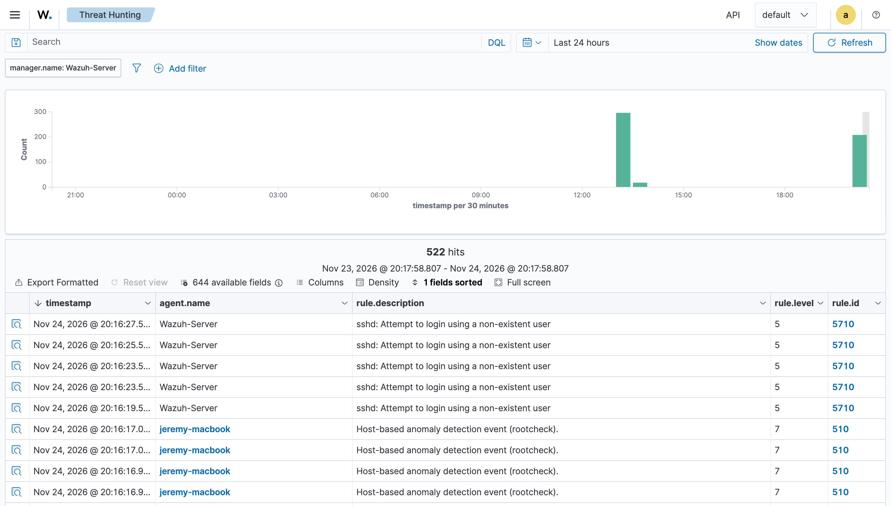

# Detection 1: Failed SSH logins

## What I did

From my Mac, I tried to SSH into the Wazuh server several times with a username that doesn't exist:

```bash
ssh wronguser@<server-ip>
```

## What Wazuh caught

Each attempt showed up in Threat Hunting within a few seconds as rule **5710**, "sshd: Attempt to login using a non-existent user", at level 5.



## Triage

- **Source:** my own IP, and I did it on purpose, so this is a known test, not an attack
- **Severity:** level 5 is low on its own. One failed login with a bad username is usually someone mistyping or a bot guessing.
- **What would make it serious:** a lot of attempts from the same IP in a short time (brute force), or a successful login right after a string of failures

## What I learned

- The full path: an action on a machine, a log line, a rule match, an alert in the dashboard
- Wazuh rates single failures low on purpose. What matters is the pattern, which is what I'm writing a custom rule for next.

## Also in the screenshot

My Mac generated several rule 510 alerts ("Host-based anomaly detection event (rootcheck)"). Rootcheck was originally written for Linux, so I'm checking whether these are real findings or normal macOS behavior.
